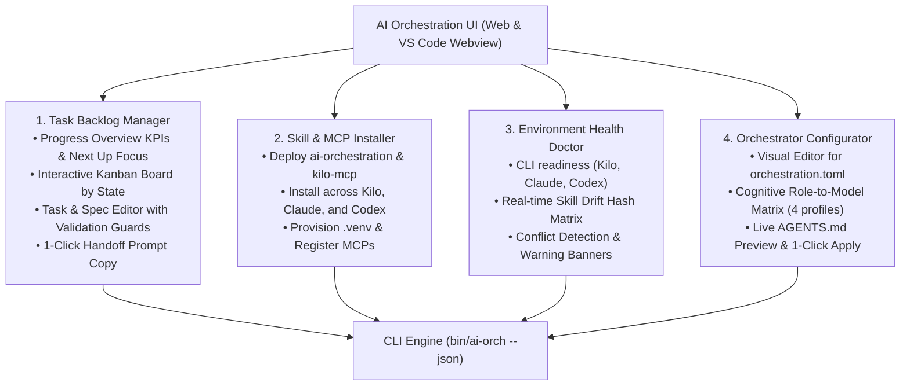

# ai-orchestration-ui

**Web UI & VS Code Webview Control Plane for [`ai-orchestration`](../ai-orchestration/).**

`ai-orchestration-ui` provides a zero-friction visual interface for managing task backlogs, installing skills/MCPs across assistants, inspecting environment drift, and configuring the project orchestrator and role profiles.

It is built as a **decoupled, embeddable architecture**:
- **In Web Mode:** A lightweight local Python backend (`backend/server.py`) powered by Starlette/Uvicorn serves the API and static bundle over `http://127.0.0.1:8780`, with WebSocket live updates whenever `tasks/` or config files change on disk.
- **In VS Code Extension Mode:** The exact same bundled frontend (`frontend/dist/`) embeds directly inside a VS Code Webview panel, communicating seamlessly via `vscode.postMessage` without rewriting a single React component (`frontend/src/api.ts`).

---

## The Four Macro-Responsibilities



1. **Macro-Task 1 — Task Backlog & Pipeline Manager:**
   - **Progress Overview:** Live KPI counters (`open`, `in progress`, `waiting/blocked`, `delivered`, `verified`, `done`), planned initiatives breakdown, and `Next up` focus queue.
   - **Interactive Kanban Board:** Columns mapped to the formal state machine.
   - **Task Detail & Spec Editor:** Modal editor for priority (`P0`–`P3`), assignee/executor (`self`, `kilo`, `claude`, `codex`), cognitive profile, verification mode (`independent-session`, `cross-agent`, `panel`, `owner`), and action buttons (`Start`, `Mark Delivered`, `Approve Verified`, `Bounce with Feedback`, `Close Done`).
2. **Macro-Task 2 — Skill & MCP Installer:**
   - Deploy skills from `ai-orchestration` (8 core skills) and `kilo-mcp` (5 bound skills + agent) across Kilo Code, Claude Code, and Codex CLI (both `global` and `project` scope), with automatic removal of obsolete pre-rename directories.
   - Provision Python `.venv` and register `kilo-mcp` and `codex-mcp` in assistant configs.
3. **Macro-Task 3 — Environment Health & Drift Doctor:**
   - Diagnostic table showing CLI binary versions (`kilo`, `claude`, `codex`) and source repo availability.
   - Interactive matrix of installed skills per assistant with color-coded drift tags (`up-to-date`, `modified-or-outdated`, `unmanaged`) and conflict warning banners.
4. **Macro-Task 4 — Project Orchestrator Configurator:**
   - Visual editor for `orchestration.toml`: Primary Orchestrator, Default Executor (with visual badge for Single-Framework Native vs. Multi-Framework MCP), and Default Verification Policy.
   - Cognitive Profile Matrix: configure models for `deep-reasoning`, `orchestration`, `bulk-execution`, and `exploration` across Kilo, Claude, and Codex.
   - Live preview of the generated `AGENTS.md` block and one-click apply button.

---

## Quickstart (Web UI Mode)

```bash
# 1. Build frontend assets (Vite + React)
cd frontend && npm install && npm run build && cd ..

# 2. Launch the backend server for a workspace (default: current directory)
./start.sh [workspace_path]
```

Open `http://127.0.0.1:8780` in your browser.

### Fixed Workspace per Process

The active workspace is fixed per backend process and cannot be modified dynamically at runtime:
- `start.sh` canonicalizes the target workspace path before directory changes and exports `AI_ORCH_WORKSPACE`.
- To manage a different workspace, start a separate server instance passing the workspace path: `./start.sh /path/to/another/repo`.

---

## Security & Authentication Model

The control plane implements strict local isolation and defense against cross-site scripting and DNS rebinding attacks:

1. **Per-Machine Secret Token:**
   - On first startup, a 32-byte urlsafe base64 token is generated and persisted at `~/.config/ai-orchestration/ui-token` with restricted permissions (`0600`).
   - The config directory can be overridden using the `AI_ORCH_CONFIG_DIR` environment variable.
   - The token persists across restarts so open tabs and sessions reconnect smoothly.
2. **Meta Tag Injection:**
   - The root page `/` and SPA fallback routes serve `index.html` with `<meta name="ai-orch-token" content="...">` dynamically injected into `<head>` and header `Cache-Control: no-store`.
   - The browser frontend reads the token from this meta tag on load.
3. **Request & WebSocket Authentication:**
   - Every REST request to `/api/*` requires the header `X-AI-Orch-Token` matching the token (constant-time comparison). Unauthorized requests are rejected with `401 {"error":"unauthorized"}`.
   - On encountering a `401`, the frontend automatically reloads the page once (sessionStorage-guarded) to refresh the token.
   - The WebSocket endpoint `/ws` requires `?token=<token>`. Invalid or missing tokens result in handshake rejection / close code `4401`.
4. **Host Header Allowlist:**
   - Requests whose `Host` header does not match `127.0.0.1:<port>` or `localhost:<port>` are rejected with `400 Invalid Host header`.
   - Allowed hosts can be customized via the `AI_ORCH_ALLOWED_HOSTS` environment variable (comma-separated list).
5. **CORS Disabled:**
   - Cross-Origin Resource Sharing (CORS) middleware is removed entirely. Cross-origin web pages cannot access or trigger endpoints.

---

## Tech Stack & Architecture

- **Backend:** Python 3.11+ / Starlette + Uvicorn (zero heavy dependencies), consuming `ai-orchestration/bin/ai-orch --json`.
- **Frontend:** React 18, TypeScript, Vite, Lucide Icons, pure responsive CSS.
- **State Synchronization:** Background file watcher (via `watchfiles` or stdlib mtime polling) with 300 ms debounce broadcasts `{"type":"changed","areas":[...]}` over `/ws` whenever `tasks/**/*.md` or configuration TOML files change.
- **VS Code Compatibility:** `frontend/src/api.ts` detects `window.acquireVsCodeApi()` and seamlessly routes requests through `vscode.postMessage` when running in the extension.

## License

[MIT](LICENSE)
